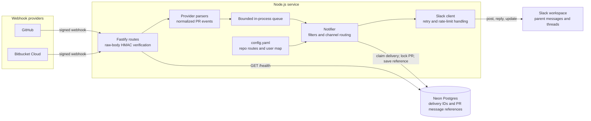

# Pull Request Slack Notifier

A long-running Node.js service that verifies GitHub and Bitbucket Cloud webhook signatures, normalizes pull request events, and delivers Block Kit notifications to Slack. Fastify acknowledges signed, supported events with `202` and sends them through a bounded in-process queue. Neon Postgres stores delivery IDs and Slack parent-message references.

## Architecture



The same normalized event contract powers both provider parsers. A transaction-scoped Postgres advisory lock serializes first-message creation for each `(platform, repo, PR ID)`; delivery IDs are claimed with `ON CONFLICT DO NOTHING`. This protects against concurrent and repeated webhook deliveries, but an in-memory queue is not durable across process crashes.

## Requirements

- Node.js 20 or newer and npm
- A Neon Postgres project with pooled and direct connection strings
- A Slack app/bot installed in the destination workspace
- Public HTTPS endpoint for provider webhooks (a tunnel is enough for local testing)

## Setup

### 1. Neon

Create a Neon project and database. Copy both connection strings from the connection details panel: select the pooled endpoint for `DATABASE_URL` (hostname contains `-pooler`) and the direct/unpooled endpoint for `DATABASE_URL_DIRECT`. Add `?sslmode=require` if it is not already present. The application uses the pooled connection; Drizzle migrations use the direct one. Neon may suspend compute while idle, so the first connection/query after a quiet period can take longer; the app retries transient connection failures three times with short backoff.

```sh
cp .env.example .env
# Set DATABASE_URL and DATABASE_URL_DIRECT in .env
npm install
npm run db:generate
npm run db:migrate
```

`db:generate` creates a migration from the Drizzle schema. Commit the generated migration with your deployment.

### 2. Slack

1. Create an app at <https://api.slack.com/apps> and add the bot scope `chat:write`. `chat:write.public` is optional; the recommended setup invites the bot into channels explicitly.
2. Install the app to the workspace and copy its `xoxb-` token into `SLACK_BOT_TOKEN`.
3. Invite the bot to each destination channel with `/invite @your-bot-name`.
4. Copy channel IDs from the channel details panel or channel URL, then set `SLACK_DEFAULT_CHANNEL_ID` and channel IDs in `config.yaml`.
5. Optional: add `users:read` if you later extend the app to resolve users at runtime. This service uses the explicit `userMap` for reviewer mentions and does not need that scope.

### 3. GitHub

In repository or organization **Settings -> Webhooks**, add `https://<host>/webhooks/github`, choose `application/json`, set a strong secret matching `GITHUB_WEBHOOK_SECRET`, and select **Pull requests**, **Pull request reviews**, and **Issue comments**. The service handles PR issue comments only; ordinary issue comments are ignored.

### 4. Bitbucket Cloud

In **Repository settings -> Webhooks**, add `https://<host>/webhooks/bitbucket`, configure the same secret as `BITBUCKET_WEBHOOK_SECRET`, and select all Pull Request triggers. The parser uses `X-Event-Key` to normalize Cloud event names.

### 5. Local testing

Set all required variables in `.env`, start the server with `npm run dev`, and expose port 3000 with ngrok or cloudflared. Configure provider webhooks with the tunnel URL. To send a correctly signed sample GitHub event to the running service:

```sh
WEBHOOK_URL=https://<your-tunnel-host> GITHUB_WEBHOOK_SECRET=<same-secret> npm run send-test-webhook
```

In PowerShell, set `$env:WEBHOOK_URL` and `$env:GITHUB_WEBHOOK_SECRET` before running `npm run send-test-webhook`. The automated suite uses realistic fixture payloads and signs an HTTP request; `npm test` runs it locally. `npm run build` checks strict TypeScript compilation.

### 6. Deploy

Build and run with Docker Compose:

```sh
docker compose up --build -d
```

The image runs a long-lived Node process and accepts `SIGTERM`, stops HTTP traffic, drains queued work, and closes the database pool. Render, Railway, Fly.io, or a VM are suitable when configured as a persistent web service. This design is not safe for serverless request lifetimes such as Vercel functions: background work after the response may be terminated. For serverless, use a durable queue and a separate worker, or complete processing before responding (which can exceed webhook response deadlines).

## Configuration

Copy `.env.example` to `.env`. All environment values are validated at startup. `DATABASE_URL` must be a pooled Neon URL; `DATABASE_URL_DIRECT` must be unpooled. Both require `sslmode=require`. Webhook secrets and the Slack token must be non-empty.

`config.yaml` accepts repo keys as `owner/repo` or `workspace/repo-slug`. Each entry has a `channelId` and optional `notifyDrafts`, `ignoreAuthors`, and `events` list. The `default` entry supplies fallback settings; `SLACK_DEFAULT_CHANNEL_ID` is used when no repo/default route is present. Event filters match normalized event names or statuses. `userMap` maps provider usernames/account IDs to Slack IDs.

Supported normalized event types include `opened`, `reopened`, `ready_for_review`, `review_requested`, `approved`, `changes_requested`, `commented`, `comment_created`, `merged`, `declined`, `closed`, `converted_to_draft`, `updated`, and `unapproved`.

## Reliability and operations

- Webhook body size is limited to 1 MiB and routes are rate-limited to 120 requests per minute per client IP.
- GitHub `X-Hub-Signature-256` and Bitbucket `X-Hub-Signature` are verified against the captured raw bytes with HMAC-SHA256 and constant-time comparison.
- Slack calls use the SDK retry policy plus bounded application retries; rate limits honor `Retry-After`. Permanent channel/auth errors are logged and not retried.
- `processed_deliveries` rows older than seven days are removed by a daily in-process cleanup task.
- Logs are structured JSON; credentials and signature headers are redacted. Webhook payloads and tokens are never logged.

## Troubleshooting

- **`not_in_channel` / `channel_not_found`:** invite the bot and verify the channel ID in `config.yaml` or `SLACK_DEFAULT_CHANNEL_ID`.
- **401 / invalid signature:** verify the secret and provider header. Signature verification uses the exact raw request body; do not parse and re-serialize before verification.
- **Duplicate messages:** confirm provider delivery IDs are present and database migrations ran. The idempotency key is provider delivery UUID; the PR parent key is `(platform, repo, pr_id)`.
- **Nothing arrives:** check `events`, ignored authors, draft settings, provider delivery logs, and application logs. Unsupported event/action shapes intentionally receive 200 and are ignored.
- **Neon connection timeout after idle:** allow for autosuspend cold starts and check the pooled URL hostname, password, and `sslmode=require`. Transient connection errors are retried, but a sustained outage still fails the job.

## Development

```sh
npm run dev
npm run build
npm test
npm run lint
```

## End-to-end checklist

- [ ] Apply migrations against the direct Neon URL.
- [ ] Start the persistent service and confirm `GET /health` reports `200`.
- [ ] Confirm the bot can post to an invited channel.
- [ ] Deliver GitHub and Bitbucket opened events and verify title, branches, reviewers, and author.
- [ ] Deliver a review/comment event and confirm it appears in the original Slack thread.
- [ ] Merge or decline a PR and confirm the root message updates.
- [ ] Replay a delivery and confirm it is ignored; test draft, ignored-author, and event filters.
- [ ] Verify invalid signatures return `401`, oversized requests are rejected, and shutdown drains jobs.

## Future improvements

A durable queue (for crash-safe delivery), Slack interactive buttons, GitHub App authentication, and Bitbucket Server/Data Center support are natural next steps.
